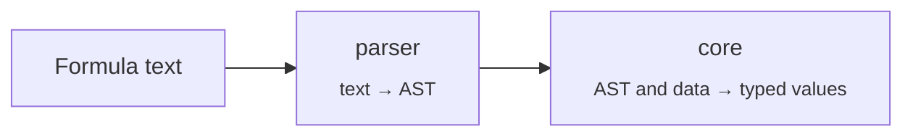

<div align="center">

# evalex

**A typed formula language for TypeScript apps — parse it, evaluate it, keep it reactive.**

[](./LICENSE)
[](https://www.typescriptlang.org/)
[](#installation)
[](https://github.com/rushelex/evalex/actions/workflows/ci.yml?query=branch%3Amain+event%3Apush)
[](https://codecov.io/gh/rushelex/evalex)

[Quick start](#quick-start) · [Language](#the-formula-language) · [Formulas in data](#formulas-in-data) · [Architecture](#architecture) · [Contributing](#development)

</div>

---

evalex (*eval* + *expression*, pronounced "ee-VAL-ex") lets the people using your product write formulas like `price * quantity * (1 - discount)` or `tasks.filter(current.done()).length()`, and gives your code a safe way to run them. Formulas see only the values you pass in, every value is typed, and errors point at the part of the formula that caused them.

## Highlights

|  |  |
| --- | --- |
| **Expressive syntax** | Infix operators, ternaries, method chains, list callbacks and `/regex/flags` literals |
| **Typed values** | Numbers, text, booleans, dates, durations, lists, objects and regular expressions |
| **Batteries included** | 50+ built-in functions and methods for text, math, lists and dates |
| **Precise errors** | Errors carry a machine-readable `code`, structured details and the span of the formula at fault |
| **Formulas in data** | Computes the formulas in your own objects and lists in the order they read each other, and again only where something changed. Fails each cell of a cycle |
| **Sandboxed** | No access to globals, no `eval`, no I/O — a formula can only read what you give it |

## Installation

> [!NOTE]
> evalex is not on npm yet. Until the first release, build it from source:

```bash
git clone https://github.com/rushelex/evalex.git
cd evalex
pnpm install
pnpm build
```

The build lands in `dist/` and exposes a single entry point, `evalex`.

## Quick start

```ts
import { FormulaScope } from 'evalex';

const scope = new FormulaScope();

const result = scope.evaluate('price * quantity * (1 - discount)', {
  price: 250,
  quantity: 4,
  discount: 0.1,
});

result.kind;  // 'Number'
result.value; // 900
```

Values are plain JavaScript: numbers, text, dates, lists, objects, class instances. Recently used formulas stay parsed, so evaluating the same text twice costs one parse. See [core](src/core/README.md#formulascope) for settings and what each value converts to.

## The formula language

```js
// Arithmetic, comparison and logic
(subtotal + shipping) * 1.2 >= 100 and not isDraft

// Ternary and if()
score >= 50 ? "pass" : "fail"
if(stock > 0, "In stock", "Sold out")

// Method chains
"  Hello  ".trim().upper()                     // "HELLO"
"Order #123, #456".match(/#\d+/)               // ["#123", "#456"]

// List callbacks: `current` is the item, `index` its position
[1, 2, 3, 4].filter(current % 2 == 0).map(current * 10)   // [20, 40]

// Objects expose their fields as methods
order.lines().map(current.qty()).sum()

// Dates and durations
dateBetween(parseDate("2026-12-31"), parseDate("2026-01-01"), "days").days()   // 364
```

<details>
<summary><b>Syntax reference</b></summary>

| Construct | Example |
| --- | --- |
| Numbers | `42`, `3.14`, `.5`, `1e3` |
| Text | `"double"` or `'single'` quotes, with `\n`, `\t`, `\uXXXX` escapes |
| Booleans, null | `true`, `false`, `null` |
| Regular expressions | `/\d+/`, `/hello/i` — same syntax as JavaScript |
| Lists | `[1, "two", true]` |
| Variables | `price`, `due_date` — resolved from the evaluation context |
| Function calls | `sum(1, 2, 3)` |
| Method calls | `"text".upper()`, `user.name()` |
| Ternary | `condition ? a : b` |

Operators, from lowest to highest precedence:

| Operators | Meaning |
| --- | --- |
| `? :` | Ternary |
| `or`, `\|\|` | Logical OR |
| `and`, `&&` | Logical AND |
| `==` `!=` `<` `<=` `>` `>=` | Comparison |
| `+` `-` | Addition, subtraction, text concatenation when either side is text |
| `*` `/` `%` | Multiplication, division, remainder |
| `^` | Power, right-associative |
| `-` `not` `!` | Unary minus and negation |

</details>

The full catalog of built-in functions, methods and data types lives in the [core README](./src/core/README.md#built-in-routines).

## Handling errors

Parse errors throw `SyntaxError`. Everything that fails during evaluation throws `FormulaError` with a machine-readable `code`:

```ts
import { FormulaError, FormulaScope } from 'evalex';

try {
  new FormulaScope().evaluate('sum("a")');
}
catch (error) {
  if (error instanceof FormulaError) {
    error.code;     // 'ARGUMENT_TYPE_MISMATCH'
    error.message;  // 'Expected type Array | Number. [4,7]'
    error.location; // { start: { offset: 4, line: 1, column: 5 }, end: { offset: 7, … } }
  }
}
```

Use `location` to underline the offending part of the formula in your editor UI.

## Formulas in data

When formulas read each other — a spreadsheet, a table with computed columns, a form with derived fields — put them right into your data with `new Formula(text)`. An evaluator gives back the same data with every formula replaced by its result:

```ts
import { Formula, FormulaScope } from 'evalex';

const evaluator = new FormulaScope().evaluator();

const order = {
  price: 100,
  total: new Formula('price * 2'),
  tax: new Formula('total * 0.1'),
};

evaluator.evaluate(order); // total = 200, tax = 20

order.price = 150;
evaluator.evaluate(order); // total = 300, tax = 30
```

A formula reads the fields of its own record and of the records around it, cells compute in the order they read each other, and a later call computes again only what changed. Cycles, failed inputs, data read through a format of your own and large data computed without blocking are covered in the [core README](./src/core/README.md#formulas-in-data).

## Architecture



| Module | What it does | Docs |
| --- | --- | --- |
| [`src/parser`](./src/parser) | Hand-written Pratt parser that turns formula text into an AST with source locations | [README](./src/parser/README.md) |
| [`src/core`](./src/core) | Evaluates formulas: data types, built-in routines, errors, and the formula cells of host data | [README](./src/core/README.md) |

Both ship in one package. `core` is re-exported from `evalex`; the parser is used internally.

## Development

You need a current Node.js and pnpm 12.

| Command | What it does |
| --- | --- |
| `pnpm build` | Bundles the library into `dist/` with tsdown |
| `pnpm dev` | Rebuilds on change |
| `pnpm test` | Runs the Vitest suite |
| `pnpm bench` | Builds, then runs benchmarks in Node and in headless Chromium |
| `pnpm typecheck` | Type-checks without emitting |
| `pnpm lint` / `pnpm lint:fix` | Lints, or lints and fixes |

Git hooks run type-checking and lint on commit, and `pnpm audit` plus tests on push. Commit messages follow [Conventional Commits](https://www.conventionalcommits.org/).

## License

[MIT](./LICENSE) © Aleksey Shelementev
