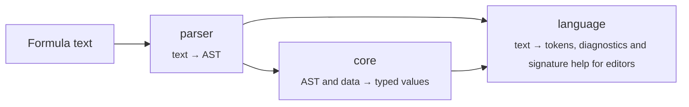

<div align="center">

# evalex

**A typed formula language for TypeScript apps — parse it, evaluate it, keep it reactive.**

[](./LICENSE)
[](https://www.typescriptlang.org/)
[](#installation)
[](https://github.com/rushelex/evalex/actions/workflows/ci.yml?query=branch%3Amain+event%3Apush)
[](https://codecov.io/gh/rushelex/evalex)

[Quick start](#quick-start) · [Language](#the-formula-language) · [Formulas in data](#formulas-in-data) · [Architecture](#architecture) · [Contributing](#development)

</div>

---

evalex (*eval* + *expression*, pronounced "ee-VAL-ex") lets the people using your product write formulas like `price * quantity * (1 - discount)` or `tasks.filter(current.done()).length()`, and gives your code a safe way to run them. Formulas see only the values you pass in, every value is typed, and errors point at the part of the formula that caused them.

## Highlights

|  |  |
| --- | --- |
| **Expressive syntax** | Infix operators, ternaries, method chains, list callbacks and `/regex/flags` literals |
| **Typed values** | Numbers, text, booleans, dates, durations, lists, objects and regular expressions |
| **Batteries included** | 50+ built-in functions and methods for text, math, lists and dates |
| **Precise errors** | Errors carry a machine-readable `code`, structured details and the span of the formula at fault |
| **Formulas in data** | Computes the formulas in your own objects and lists in the order they read each other, and again only where something changed. Fails each cell of a cycle |
| **Sandboxed** | No access to globals, no `eval`, no I/O — a formula can only read what you give it |

## Installation

> [!NOTE]
> evalex is not on npm yet. Until the first release, build it from source:

```bash
git clone https://github.com/rushelex/evalex.git
cd evalex
pnpm install
pnpm build
```

The build lands in `dist/` and exposes a single entry point, `evalex`.

Dates use the runtime's own [`Temporal`](https://developer.mozilla.org/en-US/docs/Web/JavaScript/Reference/Global_Objects/Temporal), which Chrome, Edge and Firefox, Node.js 26, Deno and Bun ship. Where it is missing, as in Safari, install `temporal-polyfill` and import it once before evalex; it uses the native `Temporal` wherever there is one:

```ts
import 'temporal-polyfill/global';
```

`new FormulaScope()` throws a `ReferenceError` when there is no `Temporal`. Dates in evalex's types are the global `Temporal` types, which TypeScript 6 brings along with evalex whatever your `lib`; on older TypeScript, also `import 'temporal-polyfill/types/global'`, or dates are typed as `any`.

## Quick start

```ts
import { FormulaScope } from 'evalex';

const scope = new FormulaScope();

const result = scope.evaluate('price * quantity * (1 - discount)', {
  price: 250,
  quantity: 4,
  discount: 0.1,
});

result.kind;  // 'Number'
result.value; // 900
```

Values are plain JavaScript: numbers, text, dates, lists, objects, class instances. Recently used formulas stay parsed, so evaluating the same text twice costs one parse. See [core](src/core/README.md#formulascope) for settings and what each value converts to.

## The formula language

```js
// Arithmetic, comparison and logic
(subtotal + shipping) * 1.2 >= 100 and not isDraft

// Ternary and if()
score >= 50 ? "pass" : "fail"
if(stock > 0, "In stock", "Sold out")

// Method chains
"  Hello  ".trim().upper()                     // "HELLO"
"Order #123, #456".match(/#\d+/)               // ["#123", "#456"]

// List callbacks: `current` is the item, `index` its position
[1, 2, 3, 4].filter(current % 2 == 0).map(current * 10)   // [20, 40]

// Objects expose their fields as methods
order.lines().map(current.qty()).sum()

// Dates and durations
dateBetween(parseDate("2026-12-31"), parseDate("2026-01-01"), "days").days()   // 364
```

<details>
<summary><b>Syntax reference</b></summary>

| Construct | Example |
| --- | --- |
| Numbers | `42`, `3.14`, `.5`, `1e3` |
| Text | `"double"` or `'single'` quotes, with `\n`, `\t`, `\uXXXX` escapes |
| Booleans, null | `true`, `false`, `null` |
| Regular expressions | `/\d+/`, `/hello/i` — same syntax as JavaScript |
| Lists | `[1, "two", true]` |
| Variables | `price`, `due_date` — resolved from the evaluation context |
| Function calls | `sum(1, 2, 3)` |
| Method calls | `"text".upper()`, `user.name()` |
| Ternary | `condition ? a : b` |

Operators, from lowest to highest precedence:

| Operators | Meaning |
| --- | --- |
| `? :` | Ternary |
| `or`, `\|\|` | Logical OR |
| `and`, `&&` | Logical AND |
| `==` `!=` `<` `<=` `>` `>=` | Comparison |
| `in` `not in` | Membership: an item of a list, a part of a text, a field of an object, a date of a date range |
| `+` `-` | Addition, subtraction, text concatenation when either side is text |
| `*` `/` `%` | Multiplication, division, remainder |
| `^` | Power, right-associative |
| `-` `not` `!` | Unary minus and negation |

</details>

The full catalog of built-in functions, methods and data types lives in the [core README](./src/core/README.md#built-in-routines).

## Handling errors

Parse errors throw `SyntaxError` with a machine-readable `code` from `SyntaxErrorCode`, such as `'UNEXPECTED_CHARACTER'`, and the `payload` its message fills in. Everything that fails during evaluation throws `FormulaError` with a machine-readable `code`:

```ts
import { FormulaError, FormulaScope } from 'evalex';

try {
  new FormulaScope().evaluate('sum("a")');
}
catch (error) {
  if (error instanceof FormulaError) {
    error.code;     // 'ARGUMENT_TYPE_MISMATCH'
    error.message;  // 'Expected type Array | Number. [4,7]'
    error.location; // { start: { offset: 4, line: 1, column: 5 }, end: { offset: 7, … } }
  }
}
```

Use `location` to underline the offending part of the formula in your editor UI.

## Formula editors

`evalex/language` gives a formula editor what it needs from the formula text. `tokenize` splits the text into tokens with their kinds, read the way the formula is evaluated:

```ts
import { tokenize } from 'evalex/language';

tokenize('round(price, 2) + x.total()').map(({ kind }) => kind);
// ['function', 'punctuation', 'name', 'punctuation', 'number', 'punctuation',
//  'operator', 'name', 'punctuation', 'method', 'punctuation', 'punctuation']
```

It never throws, so it can run on every keystroke: text that does not parse yet ends with one `invalid` token from the syntax error to the end. Each token has the same `location` as errors do.

`scope.routines()` lists the functions and methods formulas can call, with their descriptions, argument lists and examples; see the [core README](./src/core/README.md#built-in-routines). `FormulaLanguage` answers an editor from them as the formula is typed. Create one per scope; `signatureHelp` gives the call around the caret and the argument being typed, so the editor can show `round(number, [places])` with `places` marked:

```ts
import { FormulaLanguage } from 'evalex/language';

const language = new FormulaLanguage(scope);

const help = language.signatureHelp('round(price, ', 13);
help?.routines[0]?.name; // 'round'
help?.argument;          // 1
```

For a method, `routines` holds every method of the name, since the kind of the value before the dot is not known before the formula is evaluated.

`complete` gives what can be typed at the caret and the range it replaces. The host passes the fields the formula can read, with the labels authors know them by:

```ts
const { from, to, items } = language.complete('let rate = 2 in round(pr', 24, {
  fields: [{ name: 'price', label: 'Price' }],
})!;

[from, to]; // [22, 24], the text `pr`
items.slice(0, 2).map(({ kind, label, text }) => [kind, label, text]);
// [['variable', 'rate', 'rate'], ['field', 'Price', 'price']], then every function
```

Where a value goes, the items are the variables the formula declares around the caret, such as `let` names and `current` inside `filter`, then the fields, then the functions. After a dot they are the methods of the value before the dot, and for a record its fields first; inside quotes, the words the argument takes, such as the units of `dateBetween`. Every item that fits the place is given: the editor narrows the list by the text typed from `from`. Fields are passed on each call rather than once per `FormulaLanguage`, since the names a formula can read may differ from cell to cell.

A field may give the `type` of its values, a `FormulaType`. A record lists its own fields, each with a label and a type, so the type follows the formula through lists, `let` names and `current`:

```ts
const line = { kind: 'Object', fields: [{ name: 'qty', label: 'Quantity', type: { kind: 'Number' } }] } as const;

language.complete('lines.filter(current.', 21, {
  fields: [{ name: 'lines', type: { kind: 'Array', items: line } }],
})!.items[0];
// { kind: 'field', label: 'Quantity', text: 'qty' }, then the methods of a record

language.complete('title.', 6, { fields: [{ name: 'title', type: { kind: 'String' } }] });
// the methods of text only
```

A field without a type may hold any value, so after its dot every method is given.

`hover` tells what the name at the caret stands for, for a tooltip: a field with its label, a variable, or the routines a call may run, each with the type of its value:

```ts
const fields = [{ name: 'price', label: 'Price', type: { kind: 'Number' } }] as const;

language.hover('round(price, 2)', 8, { fields });
// { from: 6, to: 11, kind: 'field', label: 'Price', type: { kind: 'Number' } }

language.hover('round(price, 2)', 2, { fields })?.routines?.[0]?.description;
// 'Rounds the number to the nearest integer or to the given places.'
```

After a dot, `routines` holds the methods of the types the value before the dot may have, as completion lists them. A name the formula cannot read, a literal or an operator gives `undefined`.

`diagnose` finds the errors to underline. In text that does not parse, they are the syntax errors, read on past each one the reader can step over, so separate mistakes show at once:

```ts
language.diagnose('round(price,, 2) + max(1 2)').map(({ code, message }) => [code, message]);
// [['MISSING_ARGUMENT', 'Unexpected comma or missing argument in function call.'],
//  ['UNCLOSED_PARENTHESIS', 'Expected token ")".']]
```

The first of them is always the error evaluating the formula throws. A formula that parses is checked against the fields and their types: a name that is not a field, a function or method that does not exist, a field a record does not have, an argument a routine or an operand an operator does not take, as in `title * 2`. Each is found where evaluation fails on it whenever it gets there, also in a branch of `? :` or in an expression evaluated per item:

```ts
language.diagnose('title.round() + lines.map(current.qtty()).sum() + totl', {
  fields: [{ name: 'title', type: { kind: 'String' } }, { name: 'lines', type: { kind: 'Array', items: line } }],
}).map(({ message }) => message);
// ['Method "round" is not defined.', 'Field "qtty" is not defined.', 'Variable "totl" is not defined.']
```

An error that depends on the values rather than their types, such as a read of an empty value or a division by zero, is left to evaluation. Without `fields`, names are not checked. Each diagnostic carries the `code`, `payload`, `messageKey` and `location` of the `SyntaxError` or `FormulaError` it stands for. `messageKey` names each message, such as `syntax_error.missing_argument` or `formula_error.variable_not_defined`, so a host translates every diagnostic by it and fills in the `payload`.

For a name the formula cannot read, `suggestions` lists the names spelled like it that can stand there, closest first, in the shape `complete` returns, so the editor offers the fix as it offers completions:

```ts
language.diagnose('price * qtty', { fields: [{ name: 'price' }, { name: 'qty' }] })[0].suggestions;
// { from: 8, to: 12, items: [{ kind: 'field', label: 'qty', text: 'qty' }] }
```

## Formulas in data

When formulas read each other — a spreadsheet, a table with computed columns, a form with derived fields — put them right into your data with `new Formula(text)`. An evaluator gives back the same data with every formula replaced by its result:

```ts
import { Formula, FormulaScope } from 'evalex';

const evaluator = new FormulaScope().evaluator();

const order = {
  price: 100,
  total: new Formula('price * 2'),
  tax: new Formula('total * 0.1'),
};

evaluator.evaluate(order); // total = 200, tax = 20

order.price = 150;
evaluator.evaluate(order); // total = 300, tax = 30
```

A formula reads the fields of its own record and of the records around it, cells compute in the order they read each other, and a later call computes again only what changed. Cycles, failed inputs, data read through a format of your own and large data computed without blocking are covered in the [core README](./src/core/README.md#formulas-in-data).

## Architecture



| Module | What it does | Docs |
| --- | --- | --- |
| [`src/parser`](./src/parser) | Hand-written Pratt parser that turns formula text into an AST with source locations | [README](./src/parser/README.md) |
| [`src/core`](./src/core) | Evaluates formulas: data types, built-in routines, errors, and the formula cells of host data | [README](./src/core/README.md) |
| [`src/language`](./src/language) | Reads formula text for editors: tokens with their kinds, the syntax errors to underline, the call around the caret and what can be typed at it | [Formula editors](#formula-editors) |

All ship in one package. `core` is re-exported from `evalex`, `language` from `evalex/language`; the parser is used internally.

## Development

You need Node.js 26 and pnpm 12. `.nvmrc` names the Node.js version for nvm or fnm, and pnpm downloads it on its own when it is missing.

| Command | What it does |
| --- | --- |
| `pnpm build` | Bundles the library into `dist/` with tsdown |
| `pnpm dev` | Rebuilds on change |
| `pnpm test` | Runs the Vitest suite, the unit tests both on the native `Temporal` and on `temporal-polyfill` |
| `pnpm bench` | Builds, then runs benchmarks in Node and in headless Chromium |
| `pnpm typecheck` | Type-checks without emitting |
| `pnpm lint` / `pnpm lint:fix` | Lints, or lints and fixes |

Git hooks run type-checking and lint on commit, and `pnpm audit` plus tests on push. Commit messages follow [Conventional Commits](https://www.conventionalcommits.org/).

## License

[MIT](./LICENSE) © Aleksey Shelementev
