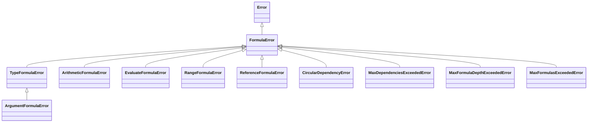
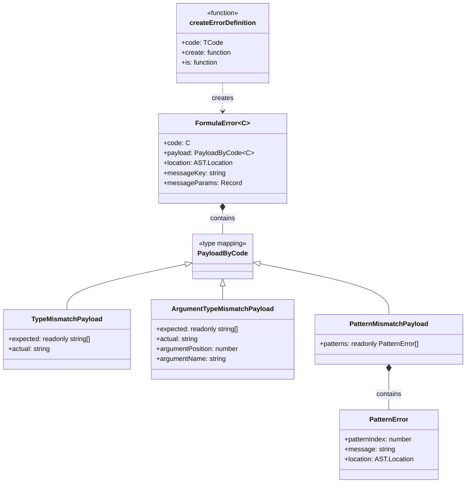

# Рефакторинг системы ошибок FormulaError

## 1. Анализ текущей архитектуры

### 1.1 Структура файлов ошибок

```
src/core/errors/
├── base.error.ts          # FormulaError - базовый класс
├── argument.error.ts      # ArgumentFormulaError
├── arithmetic.error.ts    # ArithmeticFormulaError
├── evaluate.error.ts      # EvaluateFormulaError
├── range.error.ts         # RangeFormulaError
├── reference.error.ts     # ReferenceFormulaError
└── type.error.ts          # TypeFormulaError

src/runtime/errors/
├── circular-dependency.error.ts    # CircularDependencyError
├── max-dependencies.error.ts       # MaxDependenciesExceededError
├── max-formula-depth.error.ts      # MaxFormulaDepthExceededError
└── max-formulas.error.ts           # MaxFormulasExceededError
```

### 1.2 Текущая реализация базового класса

```typescript
// src/core/errors/base.error.ts
export interface FormulaErrorContext {
  [key: string]: unknown;  // Проблема: слишком общий тип
}

export interface FormulaErrorOptions<TContext extends FormulaErrorContext = FormulaErrorContext> {
  cause?: unknown;
  context: TContext;
  location?: AST.Location;
}

export class FormulaError<TContext extends FormulaErrorContext = FormulaErrorContext> extends Error {
  readonly rawMessage: string;
  readonly context: TContext;  // Проблема: дженерик бесполезен без явного указания
  readonly location?: AST.Location;
}
```

### 1.3 Иерархия наследования



---

## 2. Выявленные проблемы

### 2.1 Бесполезная типизация context через дженерики

**Симптом:**
```typescript
// При создании ошибки тип context известен
const error = new ArgumentFormulaError('Expected type String.', {
  context: {
    argumentPosition: 1,
    expected: 'String',
    actual: 'Number',
  },
  location: node.location,
});

// Но при получении ошибки тип теряется
function handleError(error: FormulaError) {
  error.context.argumentPosition; // Type: unknown
  error.context.expected;          // Type: unknown
}
```

**Причина:** Пользователи не указывают дженерики при работе с ошибками, а TypeScript не может вывести тип `context` автоматически из экземпляра класса.

### 2.2 Агрегированные ошибки как конкатенированные строки

**Текущая реализация в `validation-error-factory.ts`:**
```typescript
createPatternMismatchError(
  patterns: readonly ArgumentsPattern[],
  patternErrors: FormulaError[],
  globalLocation: AST.Location,
): FormulaError {
  const errorMessages = patternErrors
    .map((error, i) => `Pattern ${i + 1}: ${error.rawMessage}`)
    .join('; ');

  return new ArgumentFormulaError(
    `Arguments don't match. ${errorMessages}`,  // Конкатенация!
    {
      context: {
        expected: `one of ${patterns.length} patterns`,
        actual: 'invalid',
      },
      location: globalLocation,
    },
  );
}
```

**Проблема для пользователя:**
```typescript
// Пользователь получает:
error.message // "Arguments don't match. Pattern 1: Expected type Duration.; Pattern 2: Expected at least 2 argument(s)."

// Чтобы отобразить каждую ошибку в отдельном UI-блоке, нужно парсить строку!
const parts = error.message.split('; Pattern ');
```

### 2.3 Интерфейсы context определены отдельно от классов

Каждый класс ошибки имеет свой интерфейс контекста, но связь между ними теряется при runtime:

```typescript
// ArgumentFormulaErrorContext наследует TypeFormulaErrorContext
export interface ArgumentFormulaErrorContext extends TypeFormulaErrorContext {
  argumentPosition?: number;
}

// Но при instanceof проверке мы не получаем типизацию автоматически
if (error instanceof ArgumentFormulaError) {
  error.context.argumentPosition; // Type: unknown (не number!)
}
```

### 2.4 Много файлов для добавления новой ошибки

При добавлении новой ошибки по текущей архитектуре необходимо:
1. Создать новый класс в отдельном файле
2. Создать интерфейс контекста
3. Экспортировать из `index.ts`
4. Обновить иерархию типов

**Результат:** 3-4 изменения в разных файлах для одной ошибки.

---

## 3. Анализ лучших практик

### 3.1 Подход Zod: ZodError с массивом issues

```typescript
class ZodError extends Error {
  issues: ZodIssue[];

  flatten(): { formErrors: string[]; fieldErrors: Record<string, string[]> }
  format(): FormattedError
}

interface ZodIssue {
  code: ZodIssueCode;        // Discriminated union key
  path: (string | number)[];
  message: string;
}
```

**Преимущества:**
- Структурированные данные, машиночитаемые
- Discriminated union обеспечивает типизацию

### 3.2 Подход Valibot: Issues как отдельные объекты

```typescript
interface BaseIssue {
  kind: 'schema' | 'validation' | 'transformation';
  type: string;          // Discriminant
  input: unknown;
  expected: string | null;
  received: string;
  message: string;
}
```

### 3.3 Подход TypeScript Compiler: Diagnostic

```typescript
interface Diagnostic {
  category: DiagnosticCategory;
  code: number;
  messageText: string | DiagnosticMessageChain;
  file?: SourceFile;
  start?: number;
  length?: number;
  relatedInformation?: DiagnosticRelatedInformation[];
}
```

---

## 4. Финальная архитектура

### 4.1 Основная идея: Один issue, без массива

Архитектура максимально упрощена — **один issue на ошибку**. Агрегация ошибок реализуется через специализированный `PatternMismatchPayload.patterns[]`.

### 4.2 Коды ошибок

```typescript
// src/core/errors/error-codes.ts
export const FormulaErrorCode = {
  // Core errors
  TYPE_MISMATCH: 'TYPE_MISMATCH',
  ARGUMENT_TYPE_MISMATCH: 'ARGUMENT_TYPE_MISMATCH',
  ARGUMENT_COUNT_MISMATCH: 'ARGUMENT_COUNT_MISMATCH',
  PATTERN_MISMATCH: 'PATTERN_MISMATCH',
  ARITHMETIC_ERROR: 'ARITHMETIC_ERROR',
  REFERENCE_ERROR: 'REFERENCE_ERROR',
  RANGE_ERROR: 'RANGE_ERROR',
  EVALUATE_ERROR: 'EVALUATE_ERROR',

  // Runtime errors
  CIRCULAR_DEPENDENCY: 'CIRCULAR_DEPENDENCY',
  MAX_DEPENDENCIES_EXCEEDED: 'MAX_DEPENDENCIES_EXCEEDED',
  MAX_FORMULA_DEPTH_EXCEEDED: 'MAX_FORMULA_DEPTH_EXCEEDED',
  MAX_FORMULAS_EXCEEDED: 'MAX_FORMULAS_EXCEEDED',
} as const;

export type FormulaErrorCode = typeof FormulaErrorCode[keyof typeof FormulaErrorCode];
```

### 4.3 Новый базовый класс FormulaError

```typescript
// src/core/errors/formula-error.ts
import type { AST } from '../../parser';

export class FormulaError<C extends FormulaErrorCode = FormulaErrorCode> extends Error {
  readonly code: C;
  readonly payload: PayloadByCode<C>;
  readonly location?: AST.Location;
  readonly messageKey?: string;
  readonly messageParams?: Record<string, unknown>;

  constructor(
    code: C,
    message: string,
    payload: PayloadByCode<C>,
    options?: {
      location?: AST.Location;
      messageKey?: string;
      messageParams?: Record<string, unknown>;
      cause?: Error;
    }
  ) {
    const formattedMessage = options?.location
      ? `${message} [${options.location.start.offset},${options.location.end.offset}]`
      : message;

    super(formattedMessage, options?.cause ? { cause: options.cause } : undefined);

    this.name = 'FormulaError';
    this.code = code;
    this.payload = payload;
    this.location = options?.location;
    this.messageKey = options?.messageKey;
    this.messageParams = options?.messageParams;
  }
}
```

### 4.4 Типизированные payload для каждого кода

**Важно:** `code` НЕ включается в payload — он относится только к `FormulaError`.

```typescript
// src/core/errors/error-payloads.ts

// Маппинг code -> payload
export type PayloadByCode<C extends FormulaErrorCode> =
  C extends typeof FormulaErrorCode.TYPE_MISMATCH ? TypeMismatchPayload :
  C extends typeof FormulaErrorCode.ARGUMENT_TYPE_MISMATCH ? ArgumentTypeMismatchPayload :
  C extends typeof FormulaErrorCode.ARGUMENT_COUNT_MISMATCH ? ArgumentCountMismatchPayload :
  C extends typeof FormulaErrorCode.PATTERN_MISMATCH ? PatternMismatchPayload :
  C extends typeof FormulaErrorCode.ARITHMETIC_ERROR ? ArithmeticErrorPayload :
  C extends typeof FormulaErrorCode.REFERENCE_ERROR ? ReferenceErrorPayload :
  C extends typeof FormulaErrorCode.RANGE_ERROR ? RangeErrorPayload :
  C extends typeof FormulaErrorCode.EVALUATE_ERROR ? EvaluateErrorPayload :
  C extends typeof FormulaErrorCode.CIRCULAR_DEPENDENCY ? CircularDependencyPayload :
  C extends typeof FormulaErrorCode.MAX_DEPENDENCIES_EXCEEDED ? MaxDependenciesPayload :
  C extends typeof FormulaErrorCode.MAX_FORMULA_DEPTH_EXCEEDED ? MaxFormulaDepthPayload :
  C extends typeof FormulaErrorCode.MAX_FORMULAS_EXCEEDED ? MaxFormulasPayload :
  never;

// Payload interfaces (без code!)
interface TypeMismatchPayload {
  readonly expected: readonly string[];  // Всегда массив, нормализуется в фабрике
  readonly actual: string;
}

interface ArgumentTypeMismatchPayload {
  readonly expected: readonly string[];
  readonly actual: string;
  readonly argumentPosition: number;
  readonly argumentName?: string;
}

interface ArgumentCountMismatchPayload {
  readonly expectedMin: number;
  readonly expectedMax: number;
  readonly actual: number;
}

interface PatternMismatchPayload {
  readonly patterns: readonly PatternError[];  // Может быть пустым
}

interface PatternError {
  readonly patternIndex: number;
  readonly message: string;
  readonly location?: AST.Location;
}

interface ArithmeticErrorPayload {
  readonly operation: 'division' | 'modulo';
  readonly dividend: number;
}

interface ReferenceErrorPayload {
  readonly name: string;
  readonly referenceType: 'variable' | 'function' | 'method' | 'field';
  readonly target?: string;
}

interface RangeErrorPayload {
  readonly value: number;
  readonly min?: number;
  readonly max?: number;
}

interface EvaluateErrorPayload {
  readonly expression?: string;
  readonly reason?: string;
}

interface CircularDependencyPayload {
  readonly nodeId: string;
  readonly dependsOnId: string;
}

interface MaxDependenciesPayload {
  readonly nodeId: string;
  readonly count: number;
  readonly limit: number;
}

interface MaxFormulaDepthPayload {
  readonly nodeId: string;
  readonly depth: number;
  readonly limit: number;
}

interface MaxFormulasPayload {
  readonly count: number;
  readonly limit: number;
}
```

### 4.5 Хелпер `createErrorDefinition`

Ключевое улучшение — добавление новой ошибки требует **одно изменение в одном файле**.

```typescript
// src/core/errors/create-error-definition.ts
import type { AST } from '../../parser';
import { FormulaError } from './formula-error';

interface ErrorDefinitionConfig<
  TCode extends string,
  TPayload extends PayloadByCode<TCode>,
  TArgs extends unknown[],
> {
  code: TCode;
  createPayload: (...args: TArgs) => TPayload;
  formatMessage: (payload: TPayload) => string;
  messageKey?: string;
}

export function createErrorDefinition<
  TCode extends string,
  TPayload extends PayloadByCode<TCode>,
  TArgs extends unknown[],
>(
  config: ErrorDefinitionConfig<TCode, TPayload, TArgs>
) {
  type ThisError = FormulaError<TCode> & { payload: TPayload };

  return {
    code: config.code as TCode,

    create(
      ...args: [...TArgs, location?: AST.Location, cause?: Error]
    ): ThisError {
      const { payloadArgs, location, cause } = parseArgs<TArgs>(args);
      const payload = config.createPayload(...payloadArgs);
      const message = config.formatMessage(payload);

      return new FormulaError(
        config.code,
        message,
        payload,
        {
          location,
          cause,
          messageKey: config.messageKey,
          messageParams: payload as Record<string, unknown>,
        }
      ) as ThisError;
    },

    is(error: unknown): error is ThisError {
      return error instanceof FormulaError && error.code === config.code;
    },
  };
}

function parseArgs<TArgs extends unknown[]>(args: unknown[]): {
  payloadArgs: TArgs;
  location?: AST.Location;
  cause?: Error;
} {
  let location: AST.Location | undefined;
  let cause: Error | undefined;
  let payloadArgs = args;

  // Проверяем последний аргумент на cause
  if (args.length > 0 && args.at(-1) instanceof Error) {
    const last = args.at(-1);
    if (last && last instanceof Error) {
      cause = last;
      payloadArgs = args.slice(0, -1);
    }
  }

  // Проверяем последний (или предпоследний) аргумент на location
  if (payloadArgs.length > 0) {
    const last = payloadArgs.at(-1);
    if (last && typeof last === 'object' && 'start' in last && 'end' in last) {
      location = last as AST.Location;
      payloadArgs = payloadArgs.slice(0, -1);
    }
  }

  return { payloadArgs: payloadArgs as TArgs, location, cause };
}
```

---

## 5. Определения ошибок

### 5.1 Структура файлов

```
src/core/errors/
├── formula-error.ts           # Базовый класс FormulaError
├── error-codes.ts             # Константы кодов ошибок
├── error-payloads.ts          # Типы payload и PayloadByCode
├── create-error-definition.ts # Хелпер для создания определений
├── utils.ts                   # Утилиты (formatTypes и т.д.)
├── index.ts                   # Публичный API
└── definitions/
    ├── type-mismatch.ts
    ├── argument-type-mismatch.ts
    ├── argument-count-mismatch.ts
    ├── pattern-mismatch.ts
    ├── arithmetic-error.ts
    ├── reference-error.ts
    ├── range-error.ts
    ├── evaluate-error.ts
    ├── circular-dependency.ts
    ├── max-dependencies.ts
    ├── max-formula-depth.ts
    └── max-formulas.ts
```

### 5.2 Примеры определений ошибок

**TypeMismatch:**
```typescript
// src/core/errors/definitions/type-mismatch.ts
import { createErrorDefinition } from '../create-error-definition';
import { formatTypes } from '../utils';

export const TypeMismatch = createErrorDefinition({
  code: 'TYPE_MISMATCH',

  createPayload: (expected: string | readonly string[], actual: string) => ({
    expected: Array.isArray(expected) ? expected : [expected],
    actual,
  }),

  formatMessage: (p) => `Expected type ${formatTypes(p.expected)}, got ${p.actual}.`,

  messageKey: 'errors.type_mismatch',
});
```

**ArgumentTypeMismatch:**
```typescript
// src/core/errors/definitions/argument-type-mismatch.ts
import { createErrorDefinition } from '../create-error-definition';
import { formatTypes } from '../utils';

export const ArgumentTypeMismatch = createErrorDefinition({
  code: 'ARGUMENT_TYPE_MISMATCH',

  createPayload: (
    expected: string | readonly string[],
    actual: string,
    position: number,
    name?: string
  ) => ({
    expected: Array.isArray(expected) ? expected : [expected],
    actual,
    argumentPosition: position,
    argumentName: name,
  }),

  formatMessage: (p) => `Expected type ${formatTypes(p.expected)}.`,

  messageKey: 'errors.argument_type_mismatch',
});
```

**ArgumentCountMismatch:**
```typescript
// src/core/errors/definitions/argument-count-mismatch.ts
import { createErrorDefinition } from '../create-error-definition';

export const ArgumentCountMismatch = createErrorDefinition({
  code: 'ARGUMENT_COUNT_MISMATCH',

  createPayload: (expectedRange: [number, number], actual: number) => ({
    expectedMin: expectedRange[0],
    expectedMax: expectedRange[1],
    actual,
  }),

  formatMessage: (p) => {
    if (p.actual < p.expectedMin) {
      return `Expected at least ${p.expectedMin} argument(s).`;
    }
    return `Expected at most ${p.expectedMax} argument(s).`;
  },

  messageKey: 'errors.argument_count_mismatch',
});
```

**PatternMismatch:**
```typescript
// src/core/errors/definitions/pattern-mismatch.ts
import { createErrorDefinition } from '../create-error-definition';
import type { PatternError } from '../error-payloads';

export const PatternMismatch = createErrorDefinition({
  code: 'PATTERN_MISMATCH',

  createPayload: (patterns: readonly PatternError[]) => ({ patterns }),

  formatMessage: (p) => {
    if (p.patterns.length === 0) {
      return "Arguments don't match any pattern.";
    }
    if (p.patterns.length === 1) {
      return p.patterns[0].message;
    }
    return `Arguments don't match: ${p.patterns.map((e, i) => `Pattern ${i + 1}: ${e.message}`).join('; ')}`;
  },

  messageKey: 'errors.pattern_mismatch',
});
```

**ArithmeticError:**
```typescript
// src/core/errors/definitions/arithmetic-error.ts
import { createErrorDefinition } from '../create-error-definition';

export const ArithmeticError = createErrorDefinition({
  code: 'ARITHMETIC_ERROR',

  createPayload: (operation: 'division' | 'modulo', dividend: number) => ({
    operation,
    dividend,
  }),

  formatMessage: (p) => {
    return p.operation === 'division'
      ? 'Division by zero.'
      : 'Division by zero (modulo).';
  },

  messageKey: 'errors.arithmetic_error',
});
```

**ReferenceError:**
```typescript
// src/core/errors/definitions/reference-error.ts
import { createErrorDefinition } from '../create-error-definition';

export const ReferenceError = createErrorDefinition({
  code: 'REFERENCE_ERROR',

  createPayload: (
    name: string,
    type: 'variable' | 'function' | 'method' | 'field',
    target?: string
  ) => ({
    name,
    referenceType: type,
    target,
  }),

  formatMessage: (p) => {
    const typeLabel = {
      variable: 'Variable',
      function: 'Function',
      method: 'Method',
      field: 'Field',
    }[p.referenceType];

    return `${typeLabel} "${p.name}" is not defined.`;
  },

  messageKey: 'errors.reference_error',
});
```

**CircularDependency:**
```typescript
// src/core/errors/definitions/circular-dependency.ts
import { createErrorDefinition } from '../create-error-definition';

export const CircularDependency = createErrorDefinition({
  code: 'CIRCULAR_DEPENDENCY',

  createPayload: (nodeId: string, dependsOnId: string) => ({
    nodeId,
    dependsOnId,
  }),

  formatMessage: (p) => `Circular dependency detected: ${p.nodeId} depends on ${p.dependsOnId}.`,

  messageKey: 'errors.circular_dependency',
});
```

---

## 6. Диаграмма финальной архитектуры



---

## 7. Публичный API

### 7.1 Экспорт из index.ts

```typescript
// src/core/errors/index.ts

// Базовый класс
export { FormulaError } from './formula-error';

// Коды ошибок
export { FormulaErrorCode } from './error-codes';

// Типы payload
export type {
  PayloadByCode,
  TypeMismatchPayload,
  ArgumentTypeMismatchPayload,
  ArgumentCountMismatchPayload,
  PatternMismatchPayload,
  PatternError,
  ArithmeticErrorPayload,
  ReferenceErrorPayload,
  RangeErrorPayload,
  EvaluateErrorPayload,
  CircularDependencyPayload,
  MaxDependenciesPayload,
  MaxFormulaDepthPayload,
  MaxFormulasPayload,
} from './error-payloads';

// Определения ошибок (фабрики + type guards)
export { TypeMismatch } from './definitions/type-mismatch';
export { ArgumentTypeMismatch } from './definitions/argument-type-mismatch';
export { ArgumentCountMismatch } from './definitions/argument-count-mismatch';
export { PatternMismatch } from './definitions/pattern-mismatch';
export { ArithmeticError } from './definitions/arithmetic-error';
export { ReferenceError } from './definitions/reference-error';
export { RangeError } from './definitions/range-error';
export { EvaluateError } from './definitions/evaluate-error';
export { CircularDependency } from './definitions/circular-dependency';
export { MaxDependenciesExceeded } from './definitions/max-dependencies';
export { MaxFormulaDepthExceeded } from './definitions/max-formula-depth';
export { MaxFormulasExceeded } from './definitions/max-formulas';

// Хелпер для создания кастомных ошибок
export { createErrorDefinition } from './create-error-definition';
```

---

## 8. Примеры использования

### 8.1 Создание ошибок

```typescript
// Было (старый способ)
throw new ArgumentFormulaError('Expected type String.', {
  context: {
    argumentPosition: 1,
    expected: 'String',
    actual: 'Number',
  },
  location: node.location,
});

// Стало (новый способ)
throw ArgumentTypeMismatch.create('String', 'Number', 1, node.location);

// С несколькими допустимыми типами
throw ArgumentTypeMismatch.create(['String', 'Number'], 'Boolean', 1, node.location);

// С cause для error chaining
throw ArgumentTypeMismatch.create('String', 'Number', 1, node.location, originalError);
```

### 8.2 Type Guards

```typescript
function handleError(error: FormulaError) {
  if (TypeMismatch.is(error)) {
    // TypeScript знает тип payload
    console.log(error.code);              // 'TYPE_MISMATCH'
    console.log(error.payload.expected);  // readonly string[]
    console.log(error.payload.actual);    // string
  }

  if (PatternMismatch.is(error)) {
    // Можем итерировать по вложенным ошибкам
    for (const pattern of error.payload.patterns) {
      console.log(`Pattern ${pattern.patternIndex}: ${pattern.message}`);
    }
  }
}
```

### 8.3 Switch по коду ошибки

```typescript
try {
  evaluate(formula);
} catch (e) {
  if (e instanceof FormulaError) {
    switch (e.code) {
      case FormulaErrorCode.TYPE_MISMATCH:
        showTypeMismatchUI(e.payload.expected, e.payload.actual);
        break;
      case FormulaErrorCode.PATTERN_MISMATCH:
        e.payload.patterns.forEach(p => showPatternError(p));
        break;
      case FormulaErrorCode.REFERENCE_ERROR:
        showReferenceError(e.payload.name, e.payload.referenceType);
        break;
      default:
        showGenericError(e.message);
    }
  }
}
```

### 8.4 Обработка ошибок в UI

```typescript
function ErrorDisplay({ error }: { error: FormulaError }) {
  if (PatternMismatch.is(error)) {
    const { patterns } = error.payload;

    return (
      <div className="error-group">
        <h3>Arguments dont match any pattern:</h3>
        <ul>
          {patterns.map((p, i) => (
            <li key={i}>
              <strong>Pattern {p.patternIndex + 1}:</strong> {p.message}
            </li>
          ))}
        </ul>
      </div>
    );
  }

  return (
    <div className="error">
      {error.message}
    </div>
  );
}
```

### 8.5 Локализация

```typescript
// Пользователь библиотеки может использовать любую систему локализации
function localizeError(
  error: FormulaError,
  t: (key: string, params: Record<string, unknown>) => string
): string {
  if (error.messageKey && error.messageParams) {
    return t(error.messageKey, error.messageParams);
  }
  return error.message;
}

// Пример использования с i18next
const localizedMessage = localizeError(error, i18next.t);
```

---

## 9. План миграции (одноэтапная)

> **Примечание:** Поскольку система в активной разработке и внешних пользователей ещё нет, выполняем полную миграцию за один этап без обратной совместимости.

### Шаг 1: Создание новой инфраструктуры ошибок

1. Создать `src/core/errors/error-codes.ts` — константы кодов ошибок
2. Создать `src/core/errors/error-payloads.ts` — типы payload для каждого кода
3. Создать `src/core/errors/utils.ts` — утилиты (formatTypes)
4. Создать `src/core/errors/create-error-definition.ts` — хелпер
5. Создать `src/core/errors/formula-error.ts` — новый базовый класс

### Шаг 2: Создание определений ошибок

Создать файлы в `src/core/errors/definitions/`:
1. `type-mismatch.ts`
2. `argument-type-mismatch.ts`
3. `argument-count-mismatch.ts`
4. `pattern-mismatch.ts`
5. `arithmetic-error.ts`
6. `reference-error.ts`
7. `range-error.ts`
8. `evaluate-error.ts`
9. `circular-dependency.ts`
10. `max-dependencies.ts`
11. `max-formula-depth.ts`
12. `max-formulas.ts`

### Шаг 3: Обновить index.ts

Обновить `src/core/errors/index.ts` для экспорта нового API.

### Шаг 4: Удалить старые классы ошибок

Удалить файлы из `src/core/errors/`:
- `base.error.ts`
- `argument.error.ts`
- `arithmetic.error.ts`
- `evaluate.error.ts`
- `range.error.ts`
- `reference.error.ts`
- `type.error.ts`

Удалить файлы из `src/runtime/errors/`:
- `circular-dependency.error.ts`
- `max-dependencies.error.ts`
- `max-formula-depth.error.ts`
- `max-formulas.error.ts`

### Шаг 5: Обновить все места создания ошибок

1. `src/core/routines/arguments/validation-error-factory.ts` — полный рефакторинг
2. `src/core/routines/arguments/validation-error-collector.ts` — обновить для PatternMismatch
3. `src/core/evaluator.visitor.ts` — заменить конструкторы на фабрики
4. `src/core/routines/dispatcher.ts` — аналогично
5. `src/core/data-types/string/methods.ts` — заменить создание ошибок
6. `src/core/data-types/number/methods.ts` — аналогично
7. `src/core/data-types/*/methods.ts` — все остальные типы данных
8. `src/core/routines/routines/*.ts` — обновить все рутины
9. `src/runtime/formula-validator.ts` — обновить

### Шаг 6: Рефакторинг ValidationErrorCollector

```typescript
class ValidationErrorCollector {
  collectBestError(args: ProcessedArguments, globalLocation: AST.Location): FormulaError {
    const patternErrors = this.collectPatternErrors(args, globalLocation);

    if (this.#definitions.alternatives.length > 1) {
      const bestError = this.#selectBestError(args, patternErrors);
      if (bestError) return bestError;

      // Используем новую фабрику
      return PatternMismatch.create(
        patternErrors.map((err, i) => ({
          patternIndex: i,
          message: err.message,
          location: err.location,
        })),
        globalLocation,
      );
    }

    return patternErrors[0];
  }
}
```

### Шаг 7: Обновить testing-library

1. Переписать `to-be-formula-error.ts` для работы с новым API
2. Переписать `to-throw-formula-error.ts`
3. Добавить новые matchers:
   - `toHaveErrorCode(code)` — проверка кода ошибки
   - `toHaveErrorPayload(payload)` — проверка payload

### Шаг 8: Обновить все тесты

Пройтись по всем тестам и обновить:
- Проверки на конкретные классы ошибок → проверки через type guards
- Проверки context → проверки payload

---

## 10. Сравнение подходов

| Аспект | Текущий подход | Финальный подход |
|--------|----------------|------------------|
| Типизация context | Через дженерики — теряется | Discriminated union — сохраняется |
| Агрегированные ошибки | Конкатенация строк | PatternMismatchPayload.patterns[] |
| Создание ошибок | Через конструкторы классов | Фабричные функции `.create()` |
| Добавление новой ошибки | 3-4 файла | 1 файл |
| Машиночитаемость | Низкая | Высокая |
| Tree-shaking | Плохой — много классов | Хороший — один класс + функции |
| Количество файлов классов | 11 файлов | 1 файл (FormulaError) |
| Локализация | Нет поддержки | messageKey + messageParams |
| Error chaining | Частичная поддержка | Полная поддержка через cause |

---

## 11. Преимущества финального решения

1. **Типобезопасность без дженериков** — discriminated union работает из коробки
2. **Структурированные данные** — ошибки можно анализировать программно
3. **Вложенные ошибки через payload** — для pattern mismatch и подобных случаев
4. **Один файл для новой ошибки** — `createErrorDefinition` хелпер
5. **Совместимость с Zod/Valibot паттернами** — знакомый API
6. **Лучший tree-shaking** — один класс вместо иерархии
7. **Расширяемость** — легко добавить новые коды ошибок
8. **Меньше boilerplate** — фабричные функции вместо конструкторов
9. **Поддержка локализации** — messageKey и messageParams
10. **Error chaining** — полная поддержка cause

---

## 12. Чек-лист задач для реализации

### Инфраструктура ошибок
- [ ] Создать `error-codes.ts` с константами кодов ошибок
- [ ] Создать `error-payloads.ts` с типами payload (без code в payload!)
- [ ] Создать `utils.ts` с утилитой formatTypes
- [ ] Создать `create-error-definition.ts` с хелпером
- [ ] Создать `formula-error.ts` с новым классом FormulaError
- [ ] Обновить `index.ts` для экспорта нового API

### Определения ошибок (src/core/errors/definitions/)
- [ ] Создать `type-mismatch.ts`
- [ ] Создать `argument-type-mismatch.ts`
- [ ] Создать `argument-count-mismatch.ts`
- [ ] Создать `pattern-mismatch.ts`
- [ ] Создать `arithmetic-error.ts`
- [ ] Создать `reference-error.ts`
- [ ] Создать `range-error.ts`
- [ ] Создать `evaluate-error.ts`
- [ ] Создать `circular-dependency.ts`
- [ ] Создать `max-dependencies.ts`
- [ ] Создать `max-formula-depth.ts`
- [ ] Создать `max-formulas.ts`

### Удаление старых классов (src/core/errors/)
- [ ] Удалить `base.error.ts`
- [ ] Удалить `argument.error.ts`
- [ ] Удалить `arithmetic.error.ts`
- [ ] Удалить `evaluate.error.ts`
- [ ] Удалить `range.error.ts`
- [ ] Удалить `reference.error.ts`
- [ ] Удалить `type.error.ts`

### Удаление старых классов (src/runtime/errors/)
- [ ] Удалить `circular-dependency.error.ts`
- [ ] Удалить `max-dependencies.error.ts`
- [ ] Удалить `max-formula-depth.error.ts`
- [ ] Удалить `max-formulas.error.ts`
- [ ] Обновить `index.ts` в runtime/errors

### Миграция создания ошибок
- [ ] Обновить `validation-error-factory.ts`
- [ ] Обновить `validation-error-collector.ts` (включая рефакторинг для PatternMismatch)
- [ ] Обновить `evaluator.visitor.ts`
- [ ] Обновить `dispatcher.ts`
- [ ] Обновить `src/core/data-types/string/methods.ts`
- [ ] Обновить `src/core/data-types/number/methods.ts`
- [ ] Обновить `src/core/data-types/boolean/methods.ts`
- [ ] Обновить `src/core/data-types/date/methods.ts`
- [ ] Обновить `src/core/data-types/duration/methods.ts`
- [ ] Обновить `src/core/data-types/array/methods.ts`
- [ ] Обновить `src/core/data-types/object/methods.ts`
- [ ] Обновить `src/core/data-types/null/methods.ts`
- [ ] Обновить `src/core/routines/routines/if.routine.ts`
- [ ] Обновить `src/core/routines/routines/sum.routine.ts`
- [ ] Обновить остальные рутины в `src/core/routines/routines/`
- [ ] Обновить `src/runtime/formula-validator.ts`

### Testing library
- [ ] Переписать `to-be-formula-error.ts`
- [ ] Переписать `to-throw-formula-error.ts`
- [ ] Добавить `toHaveErrorCode` matcher
- [ ] Добавить `toHaveErrorPayload` matcher
- [ ] Обновить типы в `index.ts`

### Тесты
- [ ] Обновить все тесты в `src/core/__tests__/`
- [ ] Обновить тесты в `src/core/data-types/*/`
- [ ] Обновить тесты в `src/core/routines/`
- [ ] Обновить тесты в `src/core/routines/routines/__tests__/`
- [ ] Обновить тесты в `src/testing-library/matchers/__tests__/`
- [ ] Обновить тесты в `src/runtime/__tests__/`
